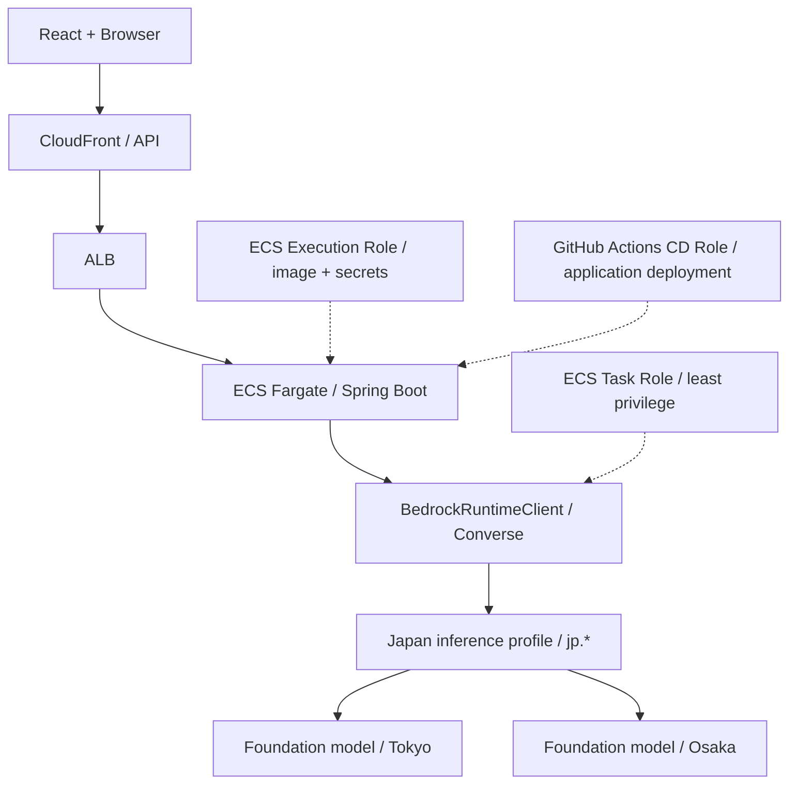

# Bedrock Deployment and Activation — Step 8H

> **Checkpoint:** Step 8H — Infrastructure preparation, not live activation
> **Date:** 2026-10-18
> **AWS source Region:** ap-northeast-1 (Tokyo)
> **Planned provider:** Amazon Bedrock Converse, Amazon Nova 2 Lite, Japan geographic inference

## 1. Purpose and scope

The Assessment backend and React UI already support provider-backed clarification through Step 8G. Step 8H prepares AWS IAM and ECS runtime configuration for Amazon Bedrock without immediately enabling model calls or changing the currently running ECS Service.

The **accepted first-choice model** for live verification is Amazon Nova 2 Lite.
This follows the project's model evaluation: Japan-resident inference,
Chinese-language task suitability, and cost/quality balance were preferred
over the former Claude candidate. The actual Chinese clarification quality,
user eligibility, quota, and terms must still be verified before activation.

The selected model IDs are:

```text
Foundation model: amazon.nova-2-lite-v1:0
Inference profile: jp.amazon.nova-2-lite-v1:0
Request Region:    ap-northeast-1 (Tokyo)
Destination Regions (expected): ap-northeast-1, ap-northeast-3 (Osaka)
```

AWS documents this Amazon Nova 2 Lite Japan inference profile and those destination Regions. **Before activation**, verify the profile from the target AWS account; model access, exact destinations, quotas, and availability are account-specific.

### Structured output implementation note

The Bedrock model card lists **native Structured Outputs** as unsupported
for Nova 2 Lite. Nova 2 Lite does support **Converse Tool Calling**, including
the `toolChoice=any` or `toolChoice=tool` alternatives for obtaining
schema-shaped tool inputs. Our existing Backend uses `toolChoice=any` with
`ask_followup` and `submit_judgement` tools, then parses and checks the
result in the Application/Infrastructure boundary.

Therefore the project's requirement is **validated Tool Calling output**,
not a claim that Nova 2 Lite supports native Bedrock JSON Schema structured
outputs. Step 8I must empirically test:
- whether the current tool schemas (including top-level
  `additionalProperties`) are accepted;
- that `toolChoice=any` reliably returns exactly one acceptable business
  action, including the final-turn `submit_judgement` path;
- that schema violations, Chinese free-text inputs, follow-up language, and
  malformed model output produce bounded failures without corrupting
  persisted Assessment decisions;
- latency and token consumption under the configured 20s total timeout
  and 1024-token limit.

Do **not** turn on strict Tool Specification schema mode merely because
the model can call tools: provider support and compatibility must be
verified against live requests first.

References: AWS Bedrock Nova 2 Lite model card and Amazon Nova 2 Tool Use guide.

## 2. Security architecture



Terraform adds an **opt-in inline policy to the ECS application Task Role**.

The policy contains three scoped statements:

1. `bedrock:InvokeModel` on the exact JP inference profile ARN in Tokyo.
2. `bedrock:InvokeModel` on only the matching foundation-model ARNs in Tokyo and Osaka, conditioned on `bedrock:InferenceProfileArn` being the exact approved JP profile.
3. `bedrock:GetInferenceProfile` on the exact approved profile ARN.

Converse (non-streaming) uses `bedrock:InvokeModel`. Streaming, Agents, Knowledge Bases, wildcard Bedrock permissions, and API keys are **not** granted.

The Execution Role remains responsible for ECR, CloudWatch logging, and injected database secrets. The GitHub CD role is not granted Bedrock permissions. ECS application code uses its Task Role credentials via AWS SDK `DefaultCredentialsProvider`.

## 3. Terraform input contract

Variables are in `infra/terraform/app/variables.tf`:

| Variable | Default | Meaning |
|---|---|---|
| `bedrock_task_access_enabled` | `false` | Create/attach exact JP Bedrock IAM policy to ECS Task Role |
| `bedrock_clarification_enabled` | `false` | Initial ECS Task Definition app flag |
| `bedrock_jp_inference_profile_id` | `jp.amazon.nova-2-lite-v1:0` | Approved Japan inference profile |
| `bedrock_foundation_model_id` | `amazon.nova-2-lite-v1:0` | Matching foundation model |
| `bedrock_clarification_max_tokens` | `1024` | Current bounded output token budget |

Validation rejects `bedrock_clarification_enabled=true` without `bedrock_task_access_enabled=true`; the profile must have the `jp.` prefix and match the foundation model; wildcard model IDs are rejected.

The bootstrap Task Definition declares:

```text
AWS_REGION                           = ap-northeast-1
BEDROCK_CLARIFICATION_ENABLED        = false
BEDROCK_CLARIFICATION_MODEL_ID       = jp.amazon.nova-2-lite-v1:0
BEDROCK_CLARIFICATION_MAX_TOKENS     = 1024
```

These are not secrets. Do not add AWS API keys or static credentials.

## 4. Mandatory Terraform / CD ownership warning

**Changing Terraform Task Definition environment values is not the same as changing the running ECS Service.**

```text
Terraform apply
   --> baseline Task Definition registration
   --> optional Task Role IAM policy
   -X-> no automatic production promotion of that Task Definition

GitHub Actions CD
   --> reads current ECS Service Task Definition
   --> creates release revision with only backend image updated
   --> registers and updates ECS Service
   --> preserves environment / roles / secrets
```

The ECS Service deliberately ignores Task Definition drift in Terraform, because CD owns application releases. Also, the selective CD workflow ignores `infra/**` changes and does not run a deploy on a Terraform-only merge.

Therefore:
- A Step 8H merge **does not** apply Terraform.
- A later operator `terraform apply` creates the scoped IAM access only when `bedrock_task_access_enabled=true`; it **does not** enable Bedrock in the running container.
- Step 8I must explicitly promote a reviewed ECS Task Definition revision to the live Service with `BEDROCK_CLARIFICATION_ENABLED=true` and the verified profile ID. This should preserve the current production image, DB secrets, logging, ports and role ARNs.
- After promotion, ordinary CD image releases preserve these Bedrock runtime settings.
- Terraform remains responsible for the IAM policy; do not attach permissions manually via the AWS Console.

## 5. Preparation checks (no deployment)

From `infra/terraform/app`:

```bash
terraform fmt -check -recursive
terraform init -backend=false -lockfile=readonly
terraform validate

# Remote-state init and plan require an operator's AWS permissions and
# the same backend configuration already used for this deployed environment.
# Never use a new local state to apply against existing production resources.
```

The PR-specific `Terraform validate` workflow performs these checks without AWS credentials, without reading production state, and without contacting the deployed ECS Service.

Before a **production** apply:

1. Use the established S3 remote backend and check the selected workspace.
2. Set `bedrock_task_access_enabled=true` explicitly; leave `bedrock_clarification_enabled=false`.
3. Review `terraform plan` to confirm the intended Task Role inline policy and any registered baseline Task Definition revision. No unrelated replacement of VPC, RDS, CloudFront, ALB, or ECS Service is acceptable.
4. Confirm `terraform apply` only after reviewing the plan and AWS account/Region.
5. Inspect the resulting task policy in IAM. Do not assume that a successful Terraform apply implies a working Bedrock model call.

## 6. Account / model verification before Step 8I

Use read-only commands (with an appropriately authorized operator identity); do not send private user answers during capability checks:

```bash
aws bedrock get-inference-profile \
  --region ap-northeast-1 \
  --inference-profile-identifier jp.amazon.nova-2-lite-v1:0 \
  --query '{arn:inferenceProfileArn,status:status,models:models[].modelArn}'

aws sts get-caller-identity
```

Check the ARN and **every** returned destination foundation-model ARN. The current Terraform policy assumes Tokyo and Osaka; a service-side destination change requires policy review before a release. Check that model use is permitted by the AWS account's model-access requirements and any SCPs.

Before enabling paid inference, set a suitable AWS Budgets alert / cost notification and confirm model pricing, quotas and expected request traffic. The Bedrock portion has no assumed fixed monthly fee; actual inference cost depends on usage.

## 7. Step 8I live rollout and rollback boundary

**Not performed in Step 8H.** Step 8I will:

1. Verify `jp.` inference profile availability, tool choice support, latency, and CloudFront timeout budget.
2. Apply scoped IAM after reviewing a remote-state Terraform plan.
3. Explicitly register an ECS Task Definition revision that changes only Bedrock environment variables, keeping the current deployed image and configuration.
4. Update the ECS Service, wait for stability, and verify the active Task Definition environment plus live Model call using a controlled authenticated Assessment.
5. Verify `RESOLVED`, `UNCLEAR`, technical failure / `FAILED_RETRYABLE`, Skip fallback, and a refresh-recovered in-progress turn.
6. Observe CloudWatch for safe errors (not raw private answers), monitor cost, and roll back by restoring `BEDROCK_CLARIFICATION_ENABLED=false` in a new task revision if necessary.

The first gate is an **explicit operator deployment**; routine CI must never invoke Bedrock.

## 8. References

- `docs/deployment/aws-deployment.md`
- `docs/deployment/ci-cd.md`
- `docs/backend/18-assessment-llm-http-boundary.md`
- `docs/frontend/09-ai-clarification-checkpoint-8gb.md`
- AWS Bedrock: inference profile and cross-Region IAM documentation
- AWS ECS: task IAM role vs execution role documentation
